# Masters panel

**Status:** Done.

## What it does

Lists the masters (Ryu's party of masters) with their portrait, pupil, counter,
each reward and what it needs, and the level-up bonus. A notice shows when a
reward is ready.

- F12: shows or hides the panel. Default: hidden.
- F10 or R / T: change page.
- 1 to 6: choose a master on the page.
- Q / E: move the selection.

## How it works

The panel reads the character record from the game's memory. The record of
Ryu is found in the process heap by its name (`Ryu`) and level (1 to 99). When
several copies exist, the one that changes while the game runs is used.

Portraits (12 masters, 40×48 pixels) are read from `src/d3d9/master_faces_data.h`. That file is a placeholder: the portrait images are third-party art and are not included. Without them the panel shows text only. See the header for the format if you want to add your own.

Level-up bonuses are listed per stat (HP, AP, Power, Defense, Agility, Wisdom),
by master id.

The panel scans memory only while it is open, because a scan stalls the game.

## Open issues

- The recomp shows the same information with F2 and from the camp menu's
  Masters command. The GOG build has no camp-menu entry yet.

## Portraits

The 12 portraits are in [`docs/images/masters`](../images/masters/). They are
read from `src/d3d9/master_faces_data.h` (40×48 pixels each, shown here at 4×).

<table>
<tr>
<td align="center">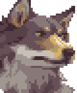 Rwolf</td>
<td align="center">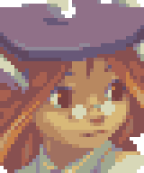 Momo</td>
<td align="center">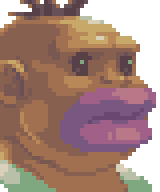 Kryrik</td>
<td align="center">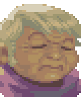 Abbess</td>
</tr>
<tr>
<td align="center">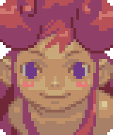 Njomo</td>
<td align="center">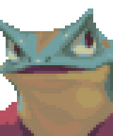 Gyosil</td>
<td align="center">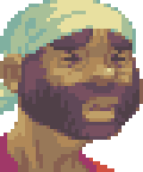 Stoll</td>
<td align="center">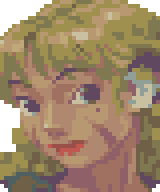 Una</td>
</tr>
<tr>
<td align="center">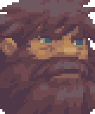 Bunyan</td>
<td align="center">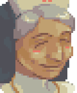 Lyta</td>
<td align="center">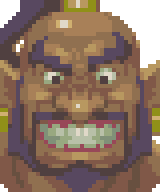 Khan</td>
<td align="center">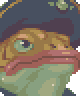 Marlok</td>
</tr>
</table>

If you add portraits, export them in the same size and name them in lower case,
so the gallery stays correct.